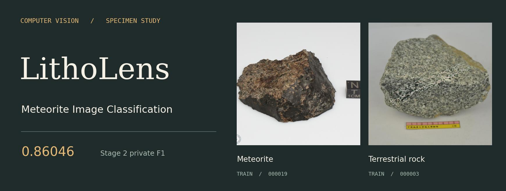
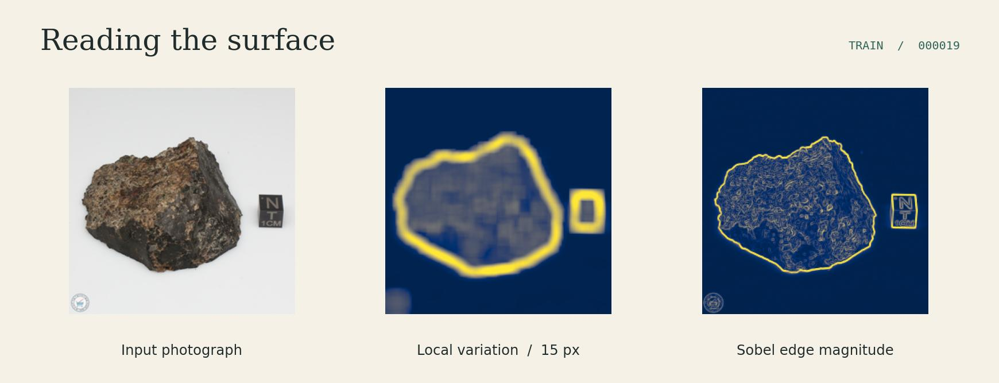
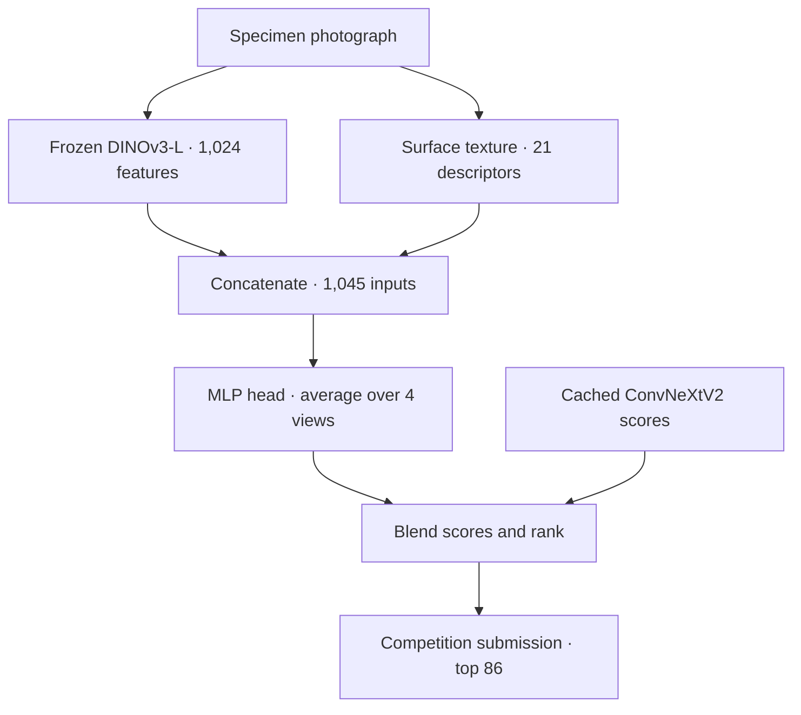

# LithoLens | Meteorite Image Classification



**只看一张照片，能分辨陨石和普通岩石吗？** 上面两块标本都有深色颗粒和不规则边缘。LithoLens 把整块岩石的视觉表征与表面的明暗变化结合起来，在课程竞赛第二阶段的私有测试集上取得 **F1 0.86046**。照片下方标注的是训练集标签。

[模型原理](#method) · [实验成绩](#results) · [复现提交](#quick-start) · [模型和数据](https://pan.baidu.com/s/11ZQfDjY0uJAMb_7RTkR_kQ?pwd=dn2w)（提取码 `dn2w`）

## Method



中图统计每个像素周围 **15 × 15** 区域的灰度变化，右图显示亮度变化最快的位置。沿标本轮廓和右侧比例尺都能看到亮边，因此背景和拍摄条件也会进入纹理统计。两幅图均由左侧照片计算得到。实现见 [纹理特征提取代码](run.py)。



DINOv3-L 从 512 × 512 的图像中提取整体表征。纹理分支在 256 × 256 灰度图上计算三个尺度的局部变化，并补充全局对比度、梯度、频域能量和直方图熵。分类头合并这两组信息，对原图和三种翻转视图分别预测，再取平均。

最终排序分数为 `0.80 × DINOv3-Texture + 0.15 × ConvNeXtV2`。比赛提交把 194 张指定测试照片中排名最高的 86 张标为正例；这个名额是该次提交的设置。

## Results


在四组使用 DINOv2 的实验中，检索与 SVM 方案取得 **0.75000**；加入纹理特征并调整分类头后达到 **0.83236**。最终方案同时更换骨干网络、加入补充训练样本并融合两个模型的分数，取得 **0.86046**。这些是完整配置的提交成绩，不能从相邻两次的差值推算单个组件的贡献。

## Quick Start

从仓库根目录执行。准备原版 Stage 2 竞赛数据，保留 `sample_submission.csv` 的原始行序。仓库内的纹理缓存按该顺序读取，ConvNeXtV2 分数对应同一批测试图片。

```text
data/
├── sample_submission.csv
└── test_images/
    └── test_images/
        ├── 000001.jpg
        └── ...
```

```bash
python -m pip install -r requirements.txt
python run.py --data_path ./data --output submission.csv
```

首次运行会通过 `timm` 加载 DINOv3-L 权重。离线运行时，在推理命令后加上 `--dino_weights ./pretrained/dinov3_large/model.safetensors` 并将权重放在对应路径。生成的 `submission.csv` 包含 `id,label` 两列。[骨干网络权重](https://huggingface.co/timm/vit_large_patch16_dinov3.lvd1689m) · [已训练分类头与竞赛缓存](checkpoints/)

<details>
<summary><strong>Training setup and experiment files</strong></summary>

训练脚本使用 5,098 张带标签的竞赛图片、2,639 张补充图片，以及 194 张带伪标签的竞赛测试图片。复现训练前，在 [train.py](train.py) 顶部设置 `DATA_ROOT` 和 `DINO_WEIGHTS`，准备 CUDA 环境，并将补充数据解压到数据根目录的 `Dataset/`。最终融合还会读取数据根目录下的 `runs/v13_proper/convnextv2_base_frozen_head_v2/test_prob.csv`，可使用仓库提供的 [ConvNeXtV2 测试分数](checkpoints/convnextv2_base_test_prob.csv)。

```bash
python train.py
```

分类头使用 512 个隐藏单元，Dropout 为 0.3。训练采用 AdamW，学习率为 `4e-5`，批量大小为 8，最多训练 20 轮，按验证 F1 早停。

| Directory | Contents |
| --- | --- |
| [Stage 1 baseline](meteorite-identification-main/) | 基线 Notebook、CNN 模型与训练工具 |
| [Stage 2 analysis](meteorite-identification-stage-2/) | 分布偏移、遮挡分析与预测融合 |
| [Training experiments](project_stage2/) | DINO、纹理分类器、集成和推理实验 |

</details>

## Team

STA326 数据科学实践 · 第 11 组 · 2026

张航源 · 陈杭楠 · 程卓 · 林敬知 · 潘昊阳
