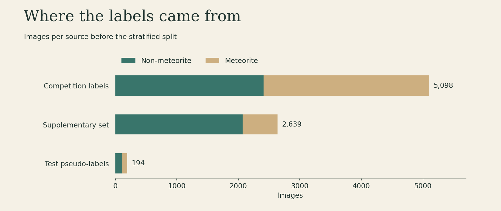
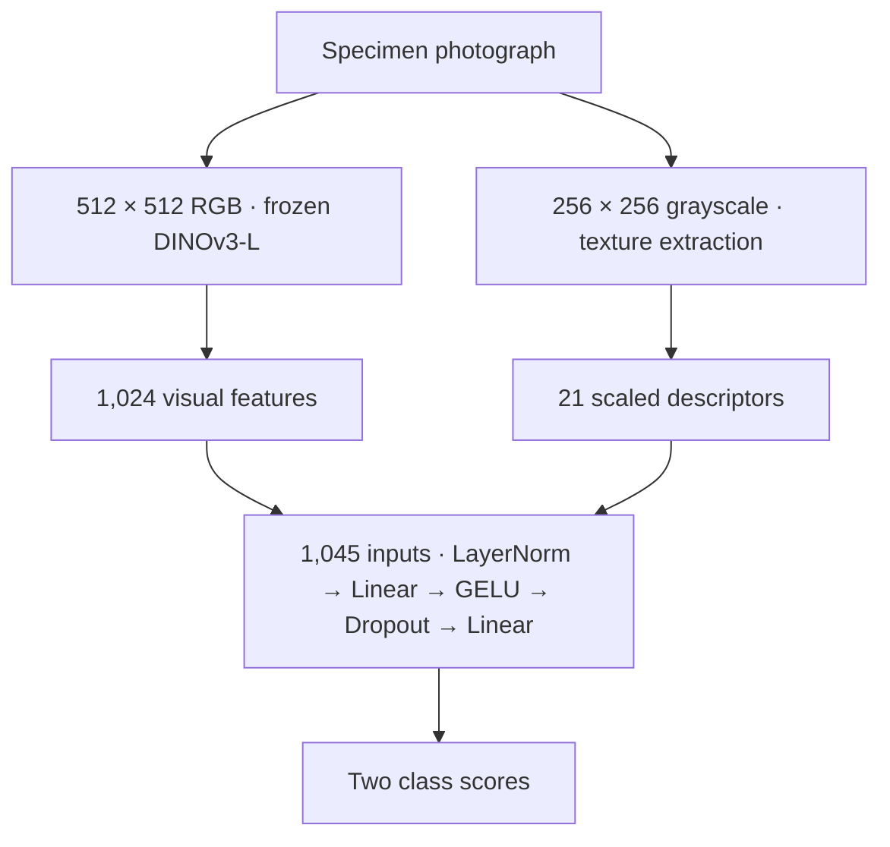
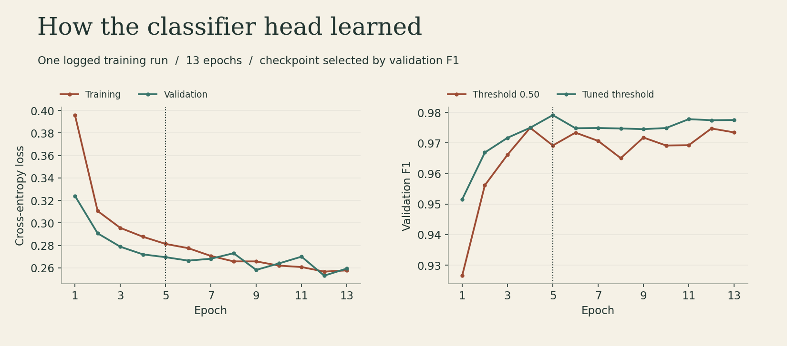
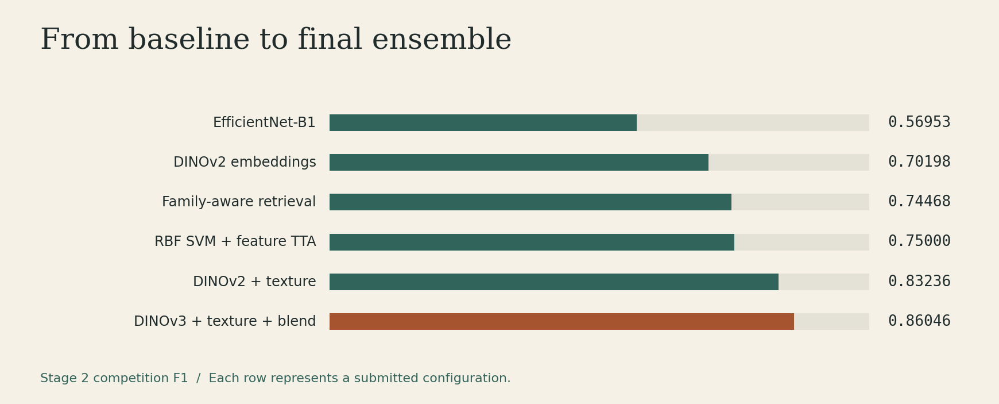
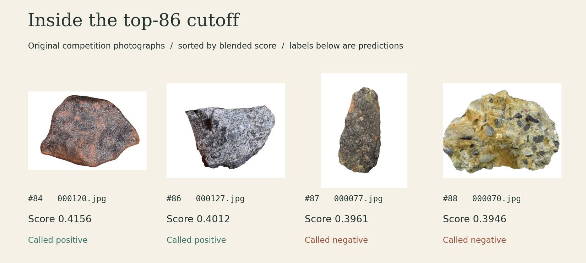

# Meteorite Classification Model


Both specimens have dark grains and irregular edges. What helps a classifier tell them apart? Our model pairs a frozen visual encoder with measurements of local contrast, edges and surface texture. The final submission reached **0.86046 F1 on the Stage 2 private competition test set**, up from **0.56953** for the supervised baseline.

[Training data](#training-data) · [Model](#what-the-model-learns) · [Learning curves](#when-training-stopped) · [Competition results](#competition-results) · [Run inference](#reproduce-the-submission)

## Training data



| Image source | Non-meteorite | Meteorite | Total |
| --- | ---: | ---: | ---: |
| Labeled competition images | 2,413 | 2,685 | 5,098 |
| Supplementary rock and meteorite images | 2,069 | 570 | 2,639 |
| Competition test images with pseudo-labels | 110 | 84 | 194 |
| **Combined pool** | **4,592** | **3,339** | **7,931** |

The original pool contains slightly more meteorites than terrestrial rocks. The supplement adds **476 quartzite, 383 marble, 369 coal, 331 limestone, 323 sandstone, 101 granite and 86 basalt images**, along with 570 meteorites. That changes the examples the classifier sees and lowers the meteorite share from 52.7% to 42.1% in the combined pool.

The training script assigns provisional labels to the 194 competition test images. It then shuffles the combined pool within each class using seed 35 and reserves 10% per class, rounded down. This gives **7,139 training images** and **792 validation images** (459 negatives and 333 positives). The validation partition can therefore contain pseudo-labels. The texture scaler also uses the combined pool before the split. Both details matter when interpreting the internal validation score. [Dataset assembly and split](train.py)

## What the model learns


The center image measures the variation in brightness inside a **15 × 15** window. The right image shows where brightness changes most sharply. The scale cube lights up along with the specimen rim: the texture branch measures the whole photograph, including its background.



1. **Encode the image.** DINOv3-L supplies 1,024 features. The texture extractor measures local variation at three window sizes (7, 15 and 31 pixels), giving 15 statistics. Global brightness spread, contrast, two Sobel statistics, high-frequency energy and histogram entropy add six more.
2. **Train the head.** The backbone stays frozen. The classifier maps 1,045 inputs to 512 hidden units and two outputs, with dropout 0.3. Random crops, flips, perspective and affine transforms, and random erasing vary the RGB input during training. The texture vector comes from the original photograph.
3. **Select a checkpoint.** Training uses batches of 8, AdamW with initial learning rate 0.00004, cosine decay and cross-entropy with label smoothing 0.1. After each epoch, the script sweeps validation thresholds from 0.05 to 0.95 in steps of 0.005 and keeps the head with the best meteorite-class F1. [Training implementation](train.py)

## When training stopped



| Epoch | Training loss | Validation loss | F1 at 0.50 | Best validation F1 | Selected threshold for epoch |
| ---: | ---: | ---: | ---: | ---: | ---: |
| 1 | 0.3958 | 0.3240 | 0.92655 | 0.95152 | 0.710 |
| **5** | **0.2813** | **0.2695** | **0.96916** | **0.97910** | **0.595** |
| 13 | 0.2578 | 0.2594 | 0.97345 | 0.97751 | 0.665 |

Training loss continued to fall after epoch 5. The next eight epochs produced no higher validation F1, so early stopping retained the epoch-5 head. The archived run's best-head file matches the published checkpoint byte for byte. The **0.97910** score measures checkpoint selection on the internal split; **0.86046** is the competition result for the complete submission. [All 13 epochs](docs/data/training-history.tsv) · [Published head](checkpoints/dinov3_tex_mlp_head.pth)

## Competition results



| Submitted configuration | Stage 2 F1 |
| --- | ---: |
| EfficientNet-B1 with a top-65 decision rule | 0.56953 |
| DINOv2 embeddings with kNN and logistic regression | 0.70198 |
| DINOv2 with retrieval over visually related examples | 0.74468 |
| Retrieval plus an RBF SVM and feature-level test-time augmentation | 0.75000 |
| DINOv2 with texture features and a stronger classifier head | 0.83236 |
| DINOv3-L, texture MLP, supplementary data, four views and ConvNeXtV2 blending | **0.86046** |

The largest step after the retrieval experiments was **0.08236 F1**, from 0.75000 to 0.83236, when both the texture inputs and classifier head changed. The course report records scores for complete submissions; it does not isolate the contribution of either change.

### Which images did the blend change?

At inference, the head predicts each specimen in four views: original, horizontal flip, vertical flip and both flips. The submission ranks images by **0.80 × mean DINOv3–texture probability + 0.15 × ConvNeXtV2 probability** and calls the highest 86 of 194 positive. The weighted value is used as a ranking score.



Compared with ranking the DINOv3–texture scores alone, blending changed two assignments. **000120** moved from rank 87 to 84 and entered the positive set. **000070** moved from 86 to 88 and left it. The final cutoff fell between scores **0.4012** and **0.3961**. These are submitted predictions. The released score file has no per-image private labels, so it cannot establish which individual calls were correct. [Scores, ranks and submitted labels for all 194 images](docs/data/test-ranking.tsv)

## Reproduce the submission

Run from the repository root using the original Stage 2 competition images and submission template. Keep the template in its original order: the bundled texture cache is indexed by row, and the bundled ConvNeXtV2 scores cover these 194 image IDs.

```text
data/
├── sample_submission.csv
└── test_images/
    └── test_images/
        ├── 000001.jpg
        └── ...
```

```bash
python -m pip install -r requirements.txt
python run.py --data_path ./data --output submission.csv
```

The output has two columns, `id` and `label`. On the first run, `timm` loads the pretrained DINOv3-L backbone. For offline inference, download the backbone first and pass `--dino_weights ./pretrained/dinov3_large/model.safetensors`. [Backbone weights](https://huggingface.co/timm/vit_large_patch16_dinov3.lvd1689m) · [Classification heads and competition caches](checkpoints/) · [Supplementary archive, access code `dn2w`](https://pan.baidu.com/s/11ZQfDjY0uJAMb_7RTkR_kQ?pwd=dn2w)

<details>
<summary><strong>Retrain the head and locate earlier experiments</strong></summary>

Set `DATA_ROOT` and `DINO_WEIGHTS` at the top of [train.py](train.py). Under the data root, provide `train_labels.csv`, `train_images/train_images/`, the test inputs shown above, and the unpacked `Dataset/` supplement. For the final blend, place the supplied [ConvNeXtV2 test scores](checkpoints/convnextv2_base_test_prob.csv) at `runs/v13_proper/convnextv2_base_frozen_head_v2/test_prob.csv` under the data root. Run on a CUDA machine:

```bash
python train.py
```

| Directory | Contents |
| --- | --- |
| [Stage 1 baseline](meteorite-identification-main/) | Training notebook, CNN models and data utilities |
| [Stage 2 analysis](meteorite-identification-stage-2/) | Distribution shift, occlusion analysis and prediction blending |
| [Training experiments](project_stage2/) | DINO, texture classifiers, ensembles and archived inference scripts |

</details>

## Team

STA326 Data Science Practice · Group 11 · 2026

Hangyuan Zhang · Hangnan Chen · Zhuo Cheng · Jingzhi Lin · Haoyang Pan
